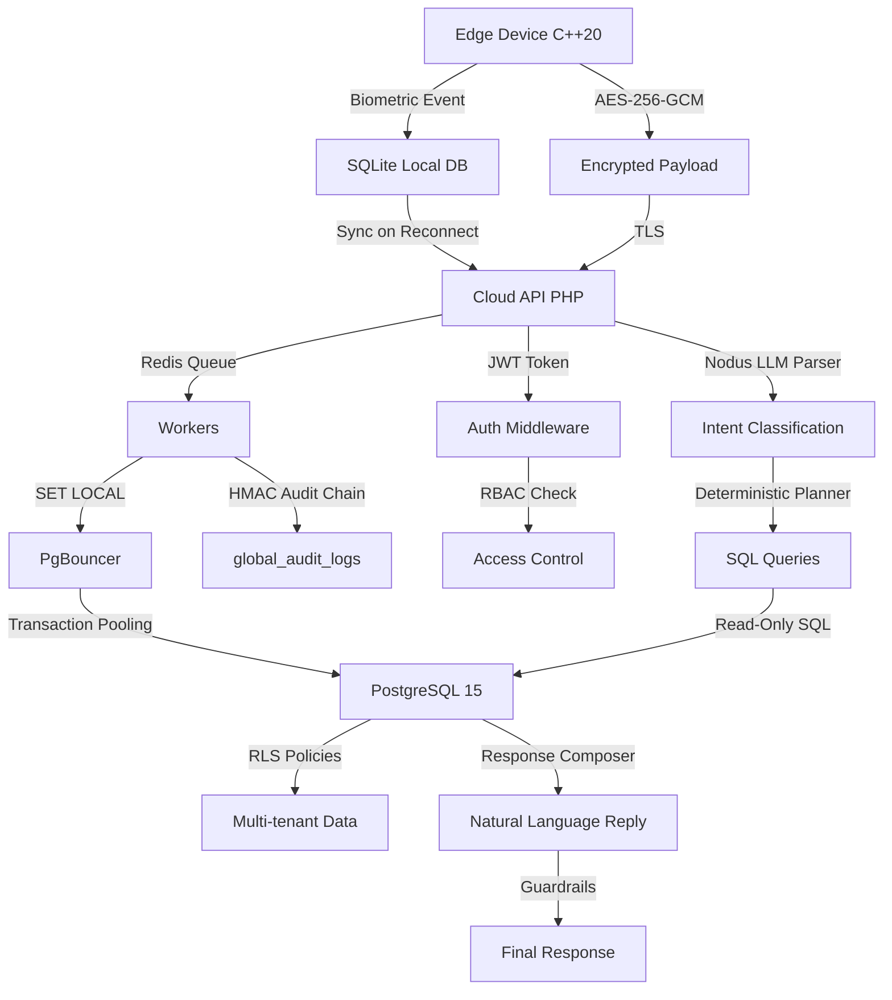

# Arquitectura de NEXO

## Flujo de datos

1. **Ingesta en el edge**: el nodo C++20 captura un evento biométrico, lo cifra con AES-256-GCM y lo persiste en SQLite con el patrón outbox
2. **Sincronización con la nube**: al reconectar, el worker de sincronización sube el payload cifrado a la API PHP vía TLS
3. **Procesamiento en cola**: la cola de Redis recibe el evento y el worker lo procesa con fingerprint idempotente
4. **Operaciones de base de datos**: el worker usa SET LOCAL para el contexto RLS a través del transaction pooling de PgBouncer
5. **Autenticación**: el middleware JWT + RBAC valida el acceso y establece el rol y el contexto de school
6. **Pipeline Nodus**: consulta en lenguaje natural → parser LLM → planner determinista → RBAC → SQL de solo lectura → composer → guardrails → respuesta
7. **Rastro de auditoría**: todos los eventos de seguridad se registran con cadena HMAC como evidencia de manipulación

## Patrones clave

- **Offline-First**: el edge funciona sin conectividad y se sincroniza cuando está disponible
- **Aislamiento multi-tenant**: RLS de PostgreSQL con SET LOCAL evita fugas entre tenants
- **Seguridad por diseño**: cifrado AES-256-GCM, cadena de auditoría HMAC, TLS, nonces anti-replay
- **LLM con guardrails**: el parser solo clasifica, las capas deterministas ejecutan y el sistema degrada sin modelo
